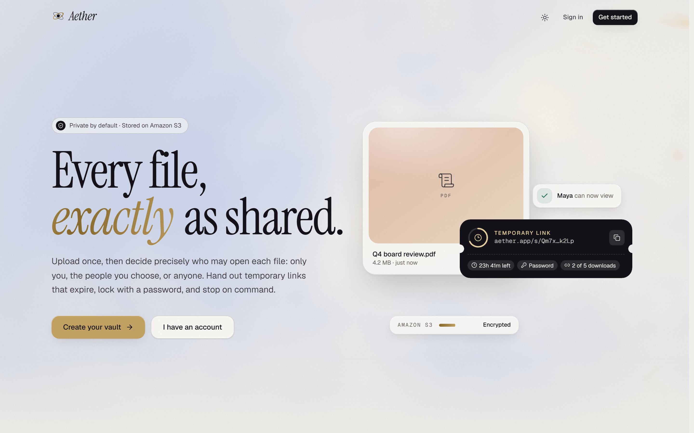
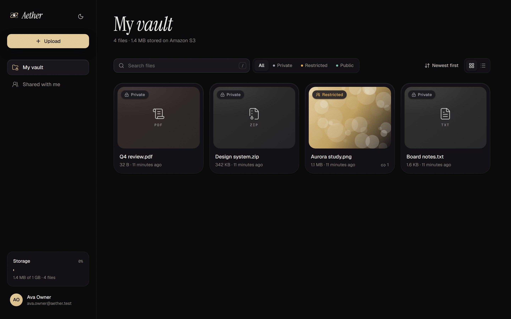
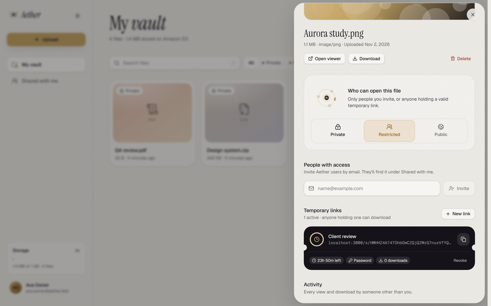
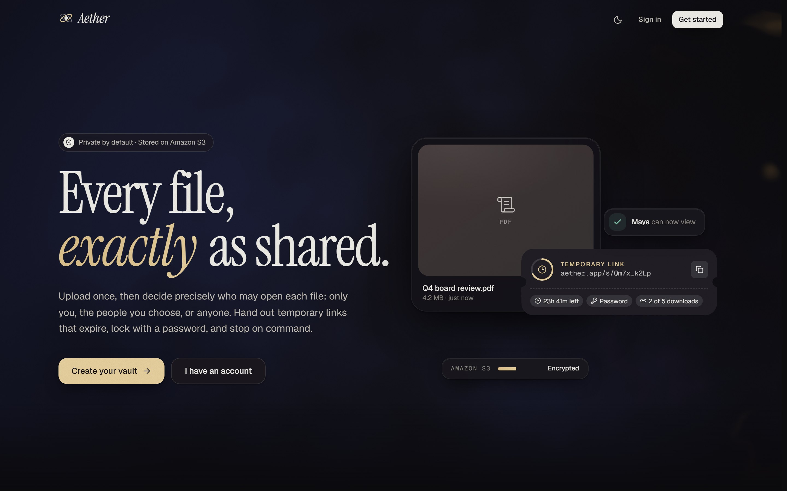
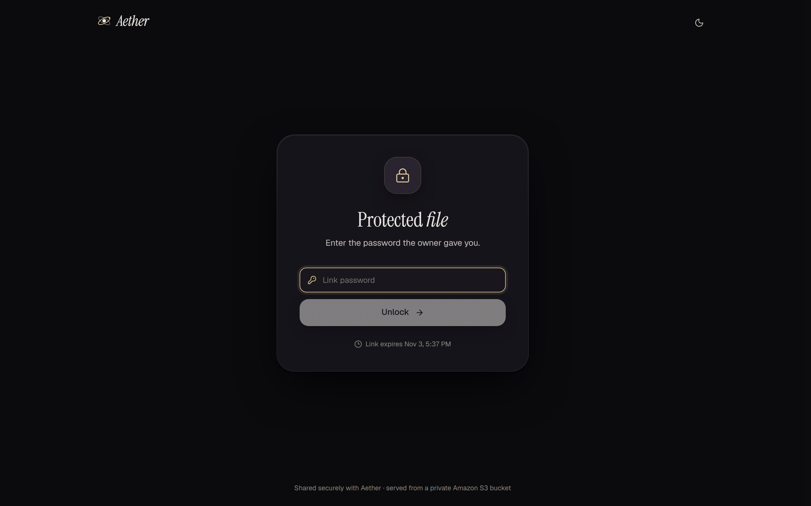
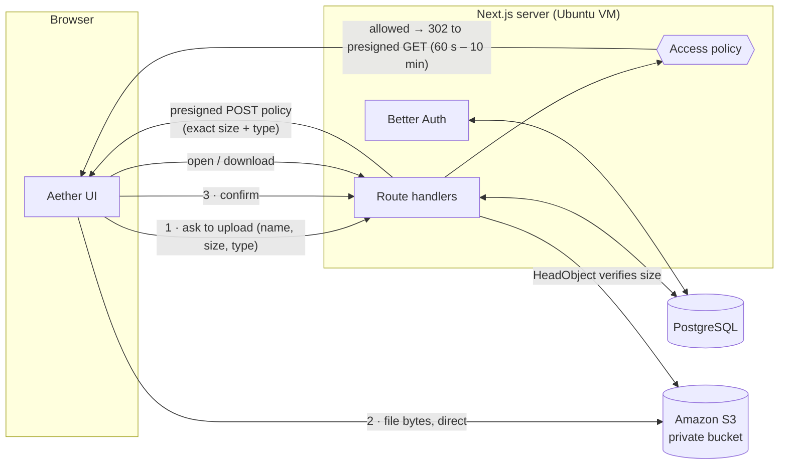

<div align="center">

# Aether

**Cloud file sharing with precise permission control.**
Upload to Amazon S3, then decide exactly who may open each file: only you, the people you choose, or anyone, with temporary links that expire, lock with a password and stop on command.

`Next.js 16` · `TypeScript` · `PostgreSQL` · `Amazon S3` · `Better Auth` · `Tailwind CSS 4` · `Motion`



</div>

| | |
| --- | --- |
|  |  |
|  |  |

---

## Project brief → what Aether delivers

| Requirement (Project 18) | How Aether meets it |
| --- | --- |
| Website to **upload files** | Drag-and-drop anywhere or the Upload button; up to 3 parallel uploads with live progress, sent **directly from the browser to S3** |
| **Amazon S3** cloud storage | One private bucket, objects at `u/<user>/<uuid>`, SSE-S3 encrypted; [setup guide](docs/AWS_SETUP.md) |
| **Authentication** | Email + password accounts (Better Auth): scrypt hashing, httpOnly session cookies, rate-limited sign-in/sign-up |
| **Private access** | Default for every upload: only the owner can open it |
| **Restricted sharing** | Invite specific registered users by email, *and/or* share **temporary access links** |
| **Temporary access links** | Expiry (1 h – 30 days), optional password, optional download limit, instant revoke, live countdown |
| **Public access** | Anyone with the file's URL can view and download, no sign-in |
| **Access control** | One central, unit-tested policy decides every request; switching a file to Private pauses all invitations and links instantly |
| **Secure data sharing** | Bucket never public; short-lived presigned URLs; hashed tokens; audit trail of every non-owner view/download |
| Ubuntu on VirtualBox | One-shot `scripts/setup-ubuntu.sh` installs Node, PostgreSQL, Git and VS Code and runs the app |

## Architecture



**Why this design**

- **The server never streams file bytes.** Uploads and downloads go straight between the browser and S3, so the app stays fast and cheap under load.
- **S3 enforces the limits.** The presigned POST policy pins the exact byte size and content type; a modified client cannot upload anything else. The `confirm` step re-checks the real object size with `HeadObject`.
- **Every read is authorised first.** `/api/files/:id/content` and `/api/s/:token/content` run the policy, log the access, then redirect to a presigned URL. The bucket has *Block all public access* on.

## Permission model

| Visibility | Owner | Invited user | Temporary link | Anyone with URL |
| --- | :---: | :---: | :---: | :---: |
| **Private** (default) | ✅ | ⏸ paused | ⏸ paused | ❌ |
| **Restricted** | ✅ | ✅ | ✅ if valid | ❌ |
| **Public** | ✅ | ✅ | ✅ if valid | ✅ |

A temporary link is *valid* while it is not revoked, not expired, has downloads left, and (if it has a password) the visitor has unlocked it. Download-limited links are download-only so the limit can't be bypassed through previews.

The rules live in one pure module, [`src/server/access/policy.ts`](src/server/access/policy.ts), covered exhaustively by unit tests.

## Security design

| Concern | Measure |
| --- | --- |
| Public exposure | S3 Block Public Access **on**; objects only reachable via presigned URLs issued after an authorisation check |
| Link tokens | 256-bit random; stored as **SHA-256 hash** (lookup) + **AES-256-GCM seal** (so owners can copy again); a database dump alone reveals no working link |
| Link passwords | scrypt-hashed; 5 attempts / 15 min per visitor and 50 per link; unlock proof is an HMAC-signed, httpOnly cookie bound to that link |
| Download limits | Atomic SQL `UPDATE … WHERE downloadCount < maxDownloads`: concurrent requests can never exceed the limit |
| Sessions | Better Auth DB sessions, httpOnly + SameSite=Lax cookies, `Secure` on HTTPS; sign-in 5/min, sign-up 3/min per IP |
| CSRF | SameSite cookies **plus** an Origin check on every state-changing request |
| Injection / XSS | Prisma parameterised queries; Zod validation on every input; strict CSP; filenames sanitised (control and bidi-override characters removed); HTML/SVG never rendered inline |
| Enumeration | Denied and missing files look identical (404); malformed tokens rejected before any lookup |
| Quotas | Per-user quota (default 1 GB) and max file size (default 100 MB), checked under a per-user Postgres advisory lock |
| Abandoned uploads | Swept automatically per user; `pnpm cleanup` removes any older than 24 h |
| Privacy | Activity log stores a keyed hash of visitor IPs, never the raw address |
| Headers | CSP, HSTS (on HTTPS), `X-Frame-Options: DENY`, `nosniff`, strict referrer policy, no `X-Powered-By`; link pages send no Referer |

## Run it on Ubuntu (VirtualBox)

Requirements: Ubuntu 22.04+ with internet access (VirtualBox NAT adapter), ~4 GB RAM, and an AWS bucket + IAM keys ([docs/AWS_SETUP.md](docs/AWS_SETUP.md)).

```bash
sudo apt-get update && sudo apt-get install -y git
git clone https://github.com/<your-username>/aether.git
cd aether
bash scripts/setup-ubuntu.sh
```

The script installs **Node.js 24 LTS, pnpm, PostgreSQL, Git and VS Code** (with recommended extensions), creates the database with a random password, writes a `chmod 600` `.env` (asking for your S3 details), runs migrations, checks the bucket, builds, and can install a systemd service. It is safe to re-run.

Then open **http://localhost:3000**. With a VirtualBox port-forward rule (host 3000 → guest 3000) the same address works from Windows.

Develop inside the VM with `code .` and `pnpm dev`.

## Run it locally with Docker (Windows / macOS / Linux)

For development without AWS, Docker provides PostgreSQL and an S3-compatible store (RustFS):

```bash
cp .env.example .env        # then set BETTER_AUTH_SECRET (openssl rand -base64 32)
docker compose up -d
pnpm install
pnpm db:migrate
pnpm storage:init
pnpm dev
```

To use real S3 instead, fill the `S3_*` values in `.env` and leave `S3_ENDPOINT` empty.

## Tests

```bash
pnpm typecheck   # TypeScript, strict
pnpm lint        # ESLint (Next.js core-web-vitals + TS)
pnpm test        # unit: access policy matrix, token crypto, filename sanitising
pnpm test:e2e    # end-to-end against the running stack
```

The end-to-end suite proves the permission model on the real stack: uploads start private, the bucket rejects unsigned reads, S3 rejects size mismatches, only owners can change files, cross-origin writes are blocked, public/restricted/invited access behaves as specified, password + download-limited links allow exactly one download, and revoked, expired or paused links stop working.

## Project structure

```
src/
  app/                    routes (App Router)
    (auth)/               sign-in, sign-up
    (app)/files, shared   authenticated vault
    f/[id]                file viewer (owner, invited, public)
    s/[token]             temporary-link page
    api/                  JSON + redirect route handlers
  server/                 server-only: env, db, auth, s3, services
    access/policy.ts      ← every access decision
    access/tokens.ts      link token crypto
  components/             UI: design system, vault, sharing, landing
  lib/                    client-safe helpers and shared types
prisma/                   schema + migrations
scripts/                  setup-ubuntu.sh, storage-init.ts, cleanup-pending.ts
tests/                    unit + e2e
docs/AWS_SETUP.md         bucket, CORS and least-privilege IAM
```

## Design

The palette is anchored on **PANTONE 11-4201 Cloud Dancer**, Pantone's Colour of the Year 2026: a cloud-white canvas for a cloud product, paired with obsidian ink and champagne gold. Each access level has its own hue (graphite, amber, jade) used consistently everywhere. Type is Instrument Serif for display and Geist for UI.

Motion is built for smoothness: only `transform` and `opacity` animate (compositor-only, so it runs at the display's native refresh rate, 120 Hz included), springs are critically damped, the landing shader renders at reduced resolution and pauses when off-screen, and everything respects `prefers-reduced-motion`.
